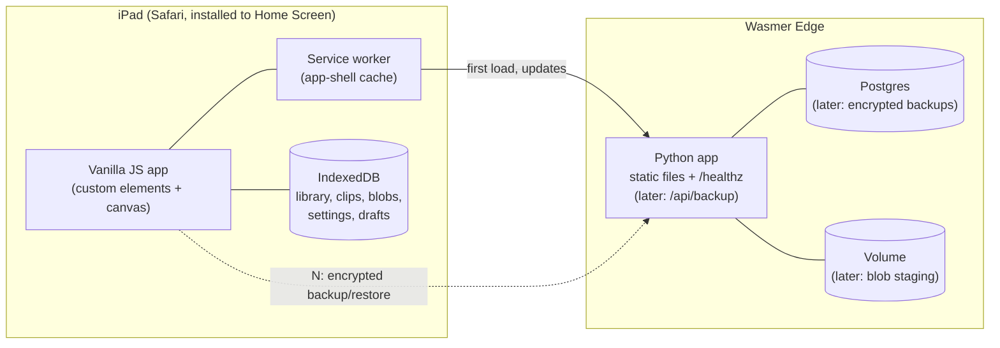
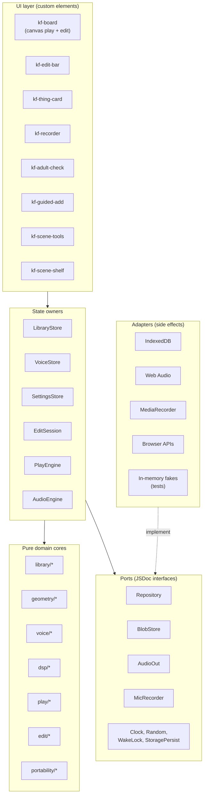
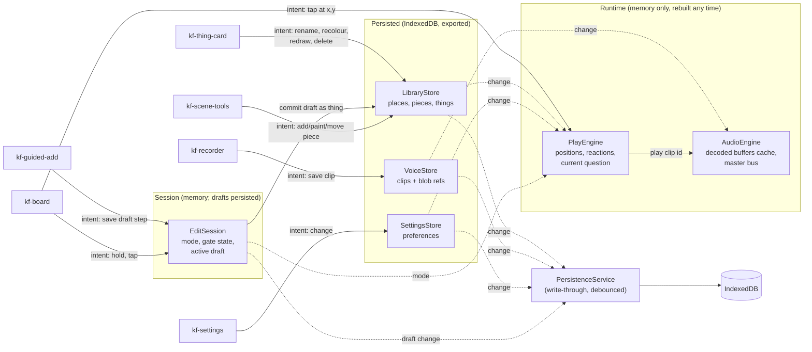
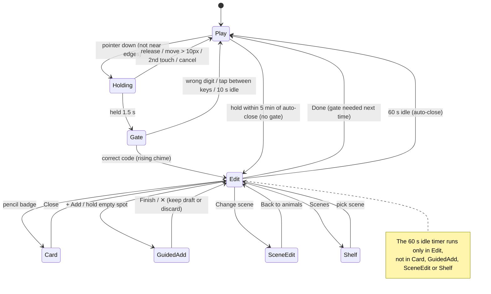
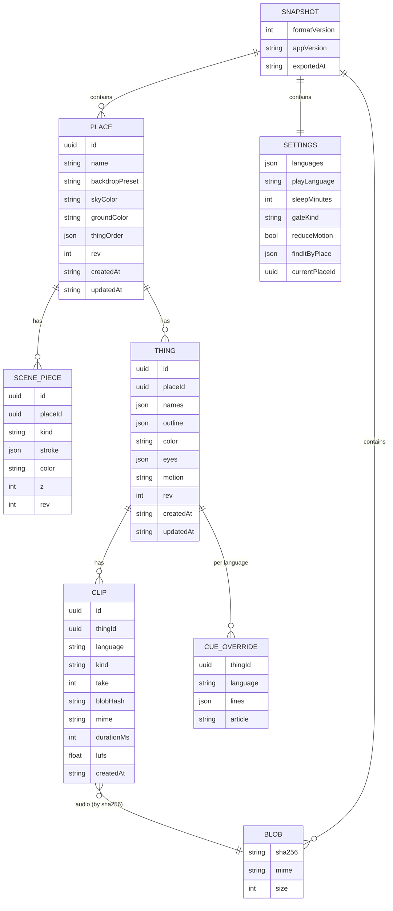
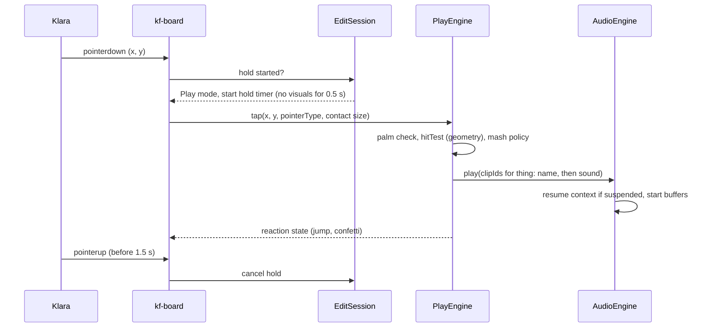
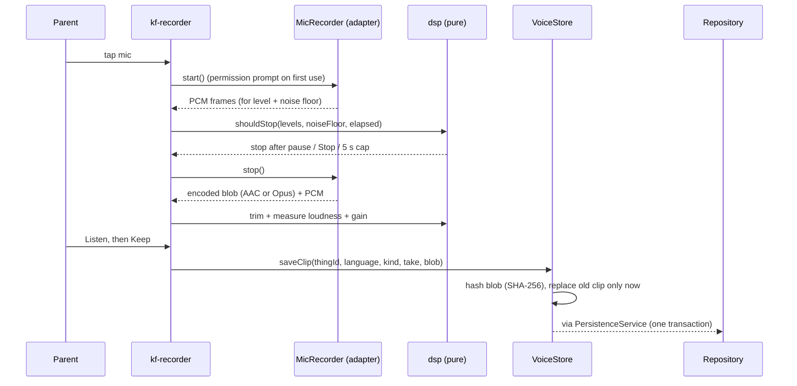
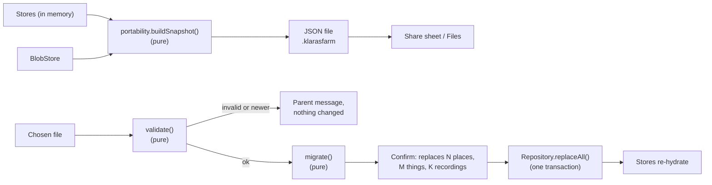

# Klara's Farm: architecture and software design

Status: proposal v1. Builds on `DESIGN.md`, `USER_STORIES.md` and the approved UX in `sketches/ux-flows.html`.

## 1. Principles

1. **Local-first.** The iPad holds the only copy of the family's data in v1. The app works offline and never waits on the network. "Local storage" here means the browser's **IndexedDB**: `localStorage` is limited to about 5 MB of strings, which can't hold voice recordings.
2. **Separation by domain.** Code is grouped by what it is about (library, voice, play, editing, portability), not by technical type. Each domain has a pure core and talks to the outside world only through ports.
3. **Functional core, imperative shell.** Domain logic is plain functions over plain data: no DOM, no IndexedDB, no `Date.now()`, no `Math.random()`. Everything with side effects lives in adapters at the edge and is injected.
4. **One writer per piece of state.** Every slice of state has exactly one owner (a store or an engine). Everyone else reads it, or asks the owner to change it.
5. **The export is the model.** The persisted data, the export file and the future server backup are the same versioned document. Nothing about the data lives only in code or only in the database.
6. **Test-first at every layer.** Pure modules get small single-process unit tests; adapters get contract tests; cross-process behaviour gets the e2e suite with real Postgres (testcontainers) and temp-dir volumes.

## 2. System context



- **v1 (M):** the Python app serves the static frontend and `/healthz`. The frontend never calls an API.
- **Later (US-8.4):** `/api/backup` receives the same snapshot document, encrypted on the device. Postgres stores it, keyed by family and content hash.

## 3. Domains

| Domain | Owns | Pure core (examples) | Persisted? |
|---|---|---|---|
| **Library** | Places, scene pieces, things | create/rename/delete place, add thing (cap of 4), validate entities | yes |
| **Geometry** | nothing (stateless) | simplify stroke, close gap, polygon fill/mask, hit test, eye snapping | no |
| **Voice** | Clips and their blobs; script templates | clip rules (5 s cap, kinds, takes), fill a template with name and article, language fallback | yes |
| **Audio processing** | nothing (stateless) | noise floor, silence trim, loudness normalise (LUFS), peak limit | no |
| **Play** | The live simulation: positions, reactions, current question | wander/steering, mash policy, reaction timing, Find it logic, sleep timer | no (ephemeral) |
| **Editing** | Mode (play, holding, gate, edit, scene edit, guided add, card), drafts | hold-gesture recogniser, adult check, auto-close rules, guided-step machine | drafts only |
| **Settings** | Family preferences | defaults, validation | yes |
| **Portability** | Nothing at runtime | snapshot build, validate, migrate between versions, import (replace) | produces files |

Dependencies point one way: **UI → stores/engines → domain cores**, and **stores → ports ← adapters**. A domain core never imports another domain's store, only its types or pure functions (Library may use Geometry; Play reads Library and Voice data passed in).

## 4. Layers



The import-boundary test (section 9) enforces these arrows.

## 5. State ownership

Each box owns its state. Solid arrows are the only allowed writes; dashed arrows are reads or subscriptions.



Rules:
- **Stores** (`LibraryStore`, `VoiceStore`, `SettingsStore`, `EditSession`) are `EventTarget` subclasses, following the vanilla-web conventions. Elements call store methods (intents) and re-render on `change`. A store method validates with the pure core, applies an immutable update, and emits one `change` event with what changed.
- **PlayEngine** owns the simulation and runs the `requestAnimationFrame` loop. It reads library, voice and settings data but never writes them, and is fully rebuildable from them. That's why nothing in play is persisted.
- **AudioEngine** owns the `AudioContext`, the decoded-buffer cache and the master limiter. It only plays clips by id; it doesn't know what a thing is.
- **PersistenceService** subscribes to persisted stores and writes changes through the `Repository` port (debounced, in one IndexedDB transaction per change set). Stores never touch IndexedDB directly.
- **Boot:** the repository hydrates the stores, and then the PlayEngine and AudioEngine are constructed from them. A failed hydration shows the storage error state from US-8.2.

## 6. Modes (EditSession)



The machine is a pure function `next(state, event, now) → state`, fed by the hold-gesture recogniser and the UI. All timing comes from an injected clock, so every arrow above is one unit test.

## 7. Data model

### 7.1 Entities



### 7.2 Decisions that keep it exportable and future-proof

- **IDs are client-generated UUIDs** (`crypto.randomUUID()`). Nothing depends on a database to assign IDs, so export, import and a later server sync can't collide.
- **Geometry is stored, never pixels.** Strokes are arrays of points normalised to the board (0–1 on both axes, 3 decimals) after simplification. Felt rendering, the tap mask and thumbnails are all derived, so a palette or renderer change never needs a data migration.
- **Colours are palette keys** (`"red"`, `"sky"`), not hex. Sunny is one palette; changing or adding palettes changes nothing in the data.
- **Audio is content-addressed.** A clip points at a blob by its SHA-256. Blobs live in their own store, are deduplicated, and are the unit of upload later (idempotent by hash). Each clip keeps its `mime` (AAC/MP4 on Safari, Opus/WebM on Chrome), duration and measured loudness.
- **Languages are BCP 47 tags** (`"sv"`, `"en-GB"`). Every clip has one from day one. `Thing.names` is a map `language → typed name`. The play language rule lives in Settings.
- **Clip kinds** are `name`, `prompt` (the "Where is the…" variants, takes 1–3) and `sound`. Uniqueness: `(thingId, language, kind, take)`.
- **Ordering is explicit** (`Place.thingOrder`, `ScenePiece.z`), never implied by insertion order.
- **Every mutable entity has `rev`** (incremented on change) and `updatedAt`. That's enough for "keep the newer one" when merge or sync arrive, with no schema change.
- **Script templates are shipped data, not user data:** `data/scripts/<lang>.json` holds `{ language, lines: ["Where is the {name}?", …], articles?: […] }`. Only per-thing edits (`CUE_OVERRIDE`) are user data.
- **Drafts** are stored in their own IndexedDB store as `{ id, step, partialThing }`. They are excluded from exports.

### 7.3 IndexedDB layout

One database `klaras-farm`, versioned with IndexedDB's own `onupgradeneeded`:

| Object store | Key | Indexes | Notes |
|---|---|---|---|
| `places` | `id` | — | includes nothing but place fields |
| `pieces` | `id` | `placeId` | scene pieces |
| `things` | `id` | `placeId` | |
| `clips` | `id` | `thingId`, `[thingId, language, kind, take]` (unique) | metadata only |
| `blobs` | `sha256` | — | `{ sha256, mime, size, bytes: Blob }` |
| `settings` | `"settings"` | — | single record |
| `drafts` | `id` | — | not exported |
| `meta` | key | — | `formatVersion`, install id |

Deleting a thing deletes its clips in the same transaction; orphaned blobs are swept on the next boot (a pure "which hashes are unreferenced" function).

### 7.4 Export format

A single `.klarasfarm` file: JSON with a `formatVersion`, the entities above, and blobs as base64. For a realistic family (around 10 places, 40 things, 200 short clips at 10–50 KB) this is a few MB, which is fine for the share sheet. If it grows, version 2 can switch to a zip without changing the entities.

```json
{
  "formatVersion": 1,
  "appVersion": "0.1.0",
  "exportedAt": "2026-11-03T13:00:00Z",
  "settings": { "languages": ["sv", "en"], "playLanguage": "alternate", "...": "..." },
  "places": [{ "id": "…", "name": "Farm", "backdropPreset": "meadow", "thingOrder": ["…"], "rev": 3 }],
  "pieces": [{ "id": "…", "placeId": "…", "kind": "shape", "stroke": [[0.12, 0.41], [0.13, 0.40]], "color": "red", "z": 2 }],
  "things": [{ "id": "…", "placeId": "…", "names": { "sv": "gris", "en": "pig" }, "outline": [[0.4, 0.6]], "color": "pink", "eyes": [[0.52, 0.48]], "motion": "walk" }],
  "clips": [{ "id": "…", "thingId": "…", "language": "sv", "kind": "name", "take": 1, "blobHash": "9f2c…", "mime": "audio/mp4", "durationMs": 820, "lufs": -16.1 }],
  "blobs": { "9f2c…": { "mime": "audio/mp4", "base64": "…" } }
}
```

Import is **validate → migrate → replace** (US-8.3): a pure `validate(snapshot)` rejects corrupt or newer files without touching storage; `migrate(snapshot)` steps `formatVersion` up one version at a time; then one transaction clears and writes every store. The later server backup stores exactly this document, encrypted on the device.

## 8. Key sequences

### Tap and hear



### Record a name



### Export and import



## 9. Code layout

```
klaras-farm/
├── app.yaml                     Wasmer Edge app (python, static, healthz)
├── backend/
│   ├── kf/
│   │   ├── config.py            reads env once → typed Settings
│   │   ├── app.py               ASGI app factory: routes + static files
│   │   ├── health.py            /healthz (process up)
│   │   └── backup/              (later, US-8.4)
│   │       ├── domain.py        snapshot envelope rules (pure)
│   │       ├── repository.py    port: BackupRepository
│   │       ├── postgres.py      adapter (pg8000, TLS, DB_* env)
│   │       └── volume.py        adapter (temp dir in tests, /data on Edge)
│   ├── migrations/0001_*.sql
│   └── tests/
│       ├── unit/                one file per module, no I/O
│       └── e2e/                 testcontainers Postgres + temp-dir volume
├── web/                         served as static files
│   ├── index.html               one document: play + edit (justified below)
│   ├── manifest.webmanifest  sw.js
│   ├── css/  main.css tokens.css (Sunny palette) …
│   ├── data/scripts/en.json sv.json …
│   └── js/
│       ├── main.js              composition root: builds adapters, stores, engines
│       ├── domain/
│       │   ├── geometry/        simplify.js close-gap.js fill.js hit-test.js snap.js
│       │   ├── library/         place.js thing.js piece.js rules.js
│       │   ├── voice/           clip.js scripts.js language.js
│       │   ├── dsp/             noise-floor.js trim.js loudness.js
│       │   ├── play/            wander.js mash.js reaction.js find-it.js sleep.js
│       │   ├── edit/            hold-gesture.js adult-check.js session.js guided.js
│       │   └── portability/     snapshot.js validate.js migrate.js
│       ├── stores/              library-store.js voice-store.js settings-store.js edit-session.js
│       ├── engines/             play-engine.js audio-engine.js persistence-service.js
│       ├── ports/               repository.js blob-store.js audio-out.js mic.js system.js (JSDoc types)
│       ├── adapters/            idb/ webaudio/ media-recorder/ browser/ fake/
│       ├── render/              felt.js palette.js (canvas drawing, no state)
│       └── components/<tag>/    Tag.js tag.js tag.css tag.test.js
└── tests/
    ├── boundaries.test.js       import rules (below)
    └── e2e/                     Playwright specs, driven by the Python e2e harness
```

- **One HTML document.** The vanilla-web skill defaults to many documents, but allows a single document when state spans sections. Here play and edit share one live board and one `EditSession`, so one document is the right call.
- **Composition root.** `main.js` is the only file that knows concrete adapters. Tests build the same graph with fakes.
- **Import boundaries** (checked by `tests/boundaries.test.js`, which parses imports):
  - `domain/**` imports only `domain/**` (and nothing from the DOM or browser globals).
  - `stores/**` and `engines/**` import `domain/**` and `ports/**`, never `adapters/**` or `components/**`.
  - `components/**` import stores and engines through properties set by `main.js`, never adapters.
  - Python: `kf/backup/domain.py` imports no I/O modules.

## 10. Backend on Wasmer Edge

- **v1 (M):** a small Python ASGI app serving `web/` with correct MIME types and cache headers (immutable hashed assets, no-cache `index.html` and `sw.js`) and `/healthz`. The framework choice (plain ASGI vs. Starlette) is settled in SPIKE-1 together with the Postgres driver.
- **app.yaml:** `kind: wasmer.io/App.v0`, `capabilities.database.engine: postgres` (never omitted; an omitted engine means MySQL) and one database region, added when backup lands; `instaboot` on `/` to hide cold starts; a volume declared only when it's needed.
- **Later (US-8.4):** `PUT /api/backup/{familyId}/{sha256}` stores the encrypted snapshot (idempotent by hash), `GET` returns the latest. The server can't read contents. Blobs go in Postgres rather than the volume, because volume writes take seconds to appear on other instances.

## 11. Testing strategy

| Layer | Test type | Runs in | Examples |
|---|---|---|---|
| `domain/**` (JS) | unit, test-first | Node's built-in test runner, single process | close-gap fixtures, hit test with overlaps, mash policy, hold recogniser with fake clock, adult check with seeded random, template fill + fallback, validate/migrate snapshots, LUFS on fixture WAVs |
| `stores/**`, `engines/**` | unit with fakes | Node, single process | store emits one `change` per intent; PersistenceService batches writes; PlayEngine pauses on finger down |
| `adapters/**` | contract tests | real browser (Playwright: WebKit, Chromium, Firefox) | IndexedDB repository passes the same contract suite as the in-memory fake; Web Audio resume after forced `suspend()` |
| `components/**` | element tests | real browser | `tag.test.js` per element, including a delayed-module pre-upgrade test |
| Python `kf/**` | unit | pytest, single process | config parsing, routes, snapshot envelope rules |
| Whole system | e2e, cross-process | pytest harness spawning the Python app as a subprocess, a **testcontainers Postgres**, a **temp dir as the volume**, and Playwright browsers | see below |

**E2E suite** (several assertions per suite, one environment per suite):
- *v1:* the harness starts Postgres and a temp volume from day one, spawns the app against them, and checks that `/healthz` responds and static assets have the right headers. In the browser it adds a thing and records with Chromium's fake microphone, reloads and asserts persistence, then exports in one browser context and imports in a second, separate one and asserts byte-identical data. Starting Postgres now, even though v1 barely uses it, proves the harness and the pg8000 TLS path early (SPIKE-1).
- *With backup (US-8.4):* back up from browser A, restore in browser B with a pairing code, restart the app process between the two, run two app processes against the same Postgres and volume, and re-upload the same hash (idempotent).

## 12. Open decisions

- Plain ASGI or Starlette (SPIKE-1).
- Whether to encrypt local IndexedDB data at rest (not needed for v1; backup is encrypted regardless).
- Parent UI language and which script languages ship first.
