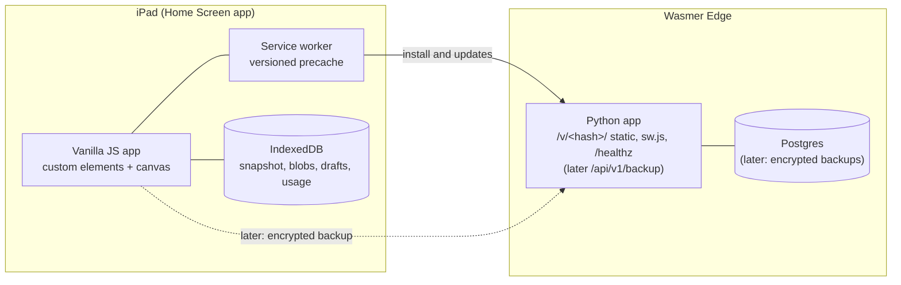
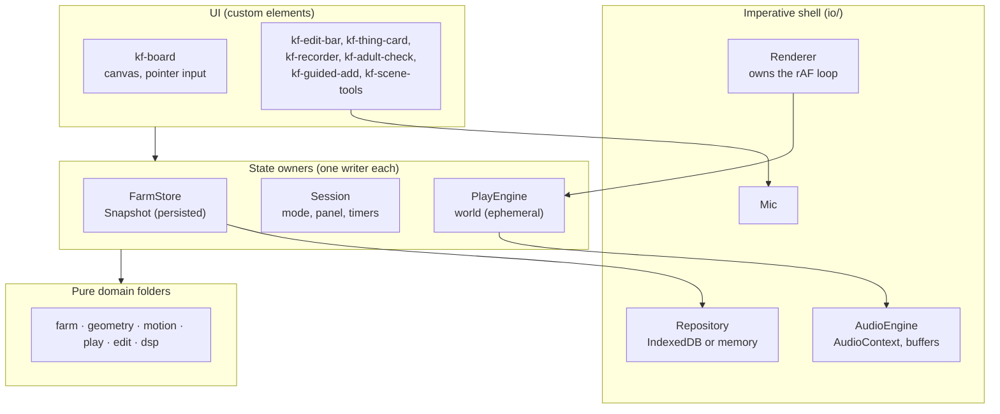
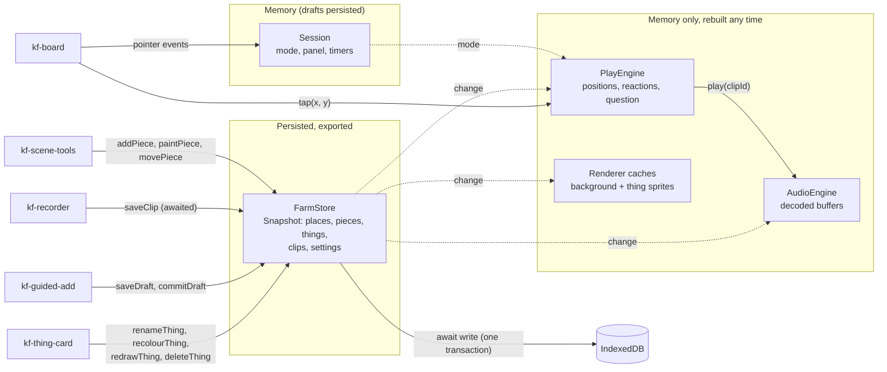
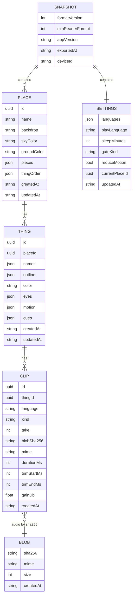
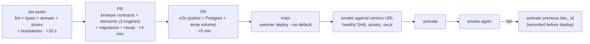

> **Historical plan.** This was the original design. The current architecture is in [`docs/`](../docs/) (one file per domain), which wins where the two disagree. See [AGENTS.md](../AGENTS.md).

# Klara's Farm: architecture and software design

Status: **v2**, revised after review by five adversarial reviewers (QA lead, product manager, iPad web-platform specialist, simplicity skeptic, data and release engineer). All five said "approve with changes"; the changes are applied below and summarised in section 16. Builds on `DESIGN.md`, `USER_STORIES.md` and the approved UX in `sketches/ux-flows.html`.

## 1. Goals and principles

The overriding goal: **small, frequent iterations with no risk of regression.** Every choice below is judged by "can one developer ship a small change on a Friday and sleep well?"

1. **Local-first.** The iPad holds the family's data. The app works offline and never waits on the network. Storage is the browser's **IndexedDB** (`localStorage` is limited to about 5 MB of strings and can't hold voice clips).
2. **Separation by domain, kept small.** Code is grouped by what it's about, in six pure domain folders. Only one thing (the repository) needs a formal port.
3. **Functional core, imperative shell.** Domain code is pure functions over plain data. Time, randomness and IDs are passed in as arguments. A lint rule bans `Date.now`, `Math.random`, `crypto.randomUUID`, `setTimeout` and `requestAnimationFrame` outside `io/` and `main.js`.
4. **One document of state, one writer.** All persisted state is one in-memory `Snapshot` owned by `FarmStore`. Every change is a pure function `(snapshot, args, env) → { snapshot, writes }`, awaited to disk before the UI says "done".
5. **The export is the model.** IndexedDB contents, the export file and the future server backup are the same versioned document.
6. **Data is never lost or rolled back.** Data formats only grow (additive changes). Old exports import forever, proven by frozen fixtures in CI.
7. **Every gate is automated except what only a real iPad can prove**, and those items are an explicit, short, path-triggered checklist.

## 2. System context



- **Now:** the Python app serves the frontend and `/healthz`. The frontend never calls an API.
- **Later (US-8.4):** `/api/v1/backup` stores client-encrypted blobs and manifests in Postgres (section 13).

## 3. Domains

| Folder | What it covers | Examples of pure functions |
|---|---|---|
| `farm/` | Places, scene pieces, things, clips, settings, and the snapshot as a whole (validate, migrate, canonicalise) | `addThing`, `deleteThing` (also removes its clips), `saveClip`, `validateSnapshot`, `migrate`, `canonicalJson`, `fillScript` |
| `geometry/` | Strokes and shapes | `simplify`, `closeGap`, `fillMask`, `hitTest`, `snapInside` |
| `motion/` | How things move (section 6) | `resolveMotion(preset, params)`, `pose(motion, t)` |
| `play/` | The live simulation | `step(world, dt, input)`, mash policy, reactions, sleep timer, Find it |
| `edit/` | Edit-mode access and navigation | `holdRecogniser`, `adultCheck`, `nextSession(state, event, now)` |
| `dsp/` | Audio analysis | `noiseFloor`, `shouldStop`, `trimPoints`, `loudness`, `gainFor` |

Rules: a domain folder imports only other domain folders and `types.js`. Nothing in them touches the DOM, IndexedDB, audio or browser globals. `tests/boundaries.test.js` parses imports and enforces this.

## 4. Runtime pieces



- **FarmStore** (`EventTarget`): holds the `Snapshot`. Intents call a pure `farm/` function, `await repo.write(writes)` in one transaction, then swap in the new snapshot and emit `change`. If the write fails, nothing changes and the intent rejects with a `FarmError`.
- **Session** (`EventTarget`): `{ mode: 'play' | 'gate' | 'edit', panel: null | 'card' | 'guided' | 'scene' | 'shelf', lastActivityAt, graceUntil }`, driven by the pure `edit/nextSession`.
- **PlayEngine**: holds the ephemeral world (positions, reactions, current question). `step(world, dt, input)` is pure, with a fixed 1/60 s timestep and an accumulator, so physics runs the same at 30 or 60 fps (Low Power Mode caps the frame rate at 30). It reads the snapshot but never writes it.
- **Renderer**: the only owner of `requestAnimationFrame`. Each frame: accumulate time, call `PlayEngine.step`, draw. The loop runs only while something moves or animates; a tap or a timer (the next wander, the next blink) wakes it. When everything is still, the app draws nothing and uses no CPU. It also stops when the page is hidden.
- **AudioEngine**: owns the `AudioContext`, the decoded-buffer cache and the master limiter. Plays clips by id with each clip's trim and gain.
- **Repository**: the only port. An IndexedDB implementation and an in-memory fake pass the same contract test suite.

## 5. State ownership



Conventions (so every module is built the same way):
- **Intents** are async verb-noun methods (`renameThing`) that resolve after the write commits and reject with `FarmError { code }`.
- **Pure validators** return `{ ok: true } | { ok: false, error }` and never throw.
- **Change events**: `new CustomEvent('change', { detail: { kind: 'thing-renamed', ids: [...] } })`, with past-tense kinds.
- **Env**: `{ now, rng, newId, deviceId }` is passed into pure functions. Tests pass fixed values.
- **Boot**: open the repository, hydrate and migrate the snapshot, build the PlayEngine, AudioEngine and Renderer from it. A `VersionError` from IndexedDB means "update needed" (section 10), never "storage error".

## 6. Motion as data

Motion is data played by a small set of tested building blocks, so animations can be tuned without code changes.

- **Building blocks** (`motion/`), each a pure function of time and parameters:
  - `travel`: ground, water or hop
  - `bob`
  - `squash`
  - `tilt`
  - `legs`: swinging sticks
  - `wave`: a body wave or wavy tentacles
  - `blink`
- **Presets** are shipped data, `web/data/motions/<id>.json`, for example:
  ```json
  { "id": "walk", "version": 1, "travel": { "mode": "ground", "speed": 0.6 },
    "legs": { "swing": 0.45, "rate": 2 }, "bob": { "amp": 2.5, "rate": 2 }, "squash": { "amp": 0.08 } }
  ```
- **Each thing stores** `motion: { preset: "walk", params: { "travel.speed": 0.8, "bob.amp": 3.5 } }`. Parameters override the preset, so a slower, bouncier pig is two numbers. Sliders in edit mode can come later at no data cost.
- **Later, custom motion** fits the same field: `motion: { kind: "keyframes", tracks: { x: [...], y: [...], tilt: [...] } }`. For example, the parent drags the animal around and the path is recorded as its dance. `kind` defaults to `"preset"`.
- `pose(motion, t)` returns a transform (position offset, rotation, scale, leg angles) that the Renderer applies to the cached sprite. Motion never changes the drawing data.
- Tests: each building block is unit tested; each preset gets a golden pose table (poses at fixed times) so a tweak is a visible, reviewed diff.

## 7. Rendering (iPad performance)

The app has a few small sprites, a still background and short audio clips, so it has no real resource needs. **Any visible lag is a design bug**, never a reason to lower quality.

- **Target device**: the weakest iPad sold from 2025 on, the base iPad (11th generation, A16, 2025), on iPadOS 18 or later. Every newer iPad (A16 and up, M-series) is faster. Budgets on the base iPad:
  - Frame work under **2 ms** CPU with 4 things moving (about an eighth of a 60 Hz frame), so 120 Hz iPads have room too.
  - **0 fps when nothing moves**: no rAF loop, no timers faster than 1 s.
  - Tap to visible reaction in the same frame; tap to sound under 50 ms.
  - Offline cold start to an interactive board under 1 s.
  - Under 100 MB memory; under 1 MB of app code and assets before the parent's own clips.
- **Background cache**: scene, felt texture, grain and stitched border are painted once into an offscreen canvas. It's rebuilt only on resize, place change or scene edit.
- **Thing sprites**: each thing's felt parts (fill, texture, inset stitch, shadow) are pre-rendered once, at the device pixel ratio, into sprites: body, head, and limbs as separate small sprites. Per frame, only `drawImage` with transforms runs. `shadowBlur`, dashed strokes, filters and clipping (all slow on WebKit) never run per frame. Confetti uses a small fixed pool of pre-rendered pieces.
- **Draw only what changed**: each frame clears and redraws only the boxes the moving sprites cover (dirty rectangles), copied from the background cache.
- **No work on the hot path**: no allocation per frame (reused objects, no closures in the loop), no layout reads or DOM writes per frame, no decoding audio on tap (clips are decoded once into buffers).
- **Coordinates**: the board is fixed at **4:3**, and all stored geometry is normalised to it (0–1 on both axes). In portrait the board is letterboxed.
- **Memory**: canvases that are no longer used are released (`width = 0`), because iOS has a hard limit on total canvas memory. No OffscreenCanvas or workers; none are needed.
- **Enforced in CI**: a benchmark spec drives the play loop for 10 s on Chromium with 6× CPU throttling (slower than an A16) and fails if the 95th-percentile frame work exceeds 2 ms, if anything is allocated per frame in steady state, or if the idle board requests a frame. The real-iPad checklist adds a 2-minute Safari Timelines recording on the base iPad.

## 8. Audio and recording (iPad realities)

- **Unlock and resume**: `AudioContext.resume()` is called synchronously inside the gesture handler on `pointerdown` and `pointerup`. The `suspended` and WebKit's `interrupted` states are handled; the next tap resumes and plays.
- **Audio session**: `navigator.audioSession.type = "playback"` during play, so the mute switch doesn't silence the voices. It switches to `"play-and-record"` only while recording, and back afterwards.
- **Buffers**: all clips of the current place are decoded when the place loads (needed for the latency budget). An LRU cache has a byte budget, since decoded audio is about 190 KB per second. `decodeAudioData` receives a copy, because it detaches its input.
- **Recording**:
  - `getUserMedia` runs with auto gain control, noise suppression and echo cancellation all off.
  - An `AnalyserNode` drives the level meter and auto-stop (noise floor in the first 300 ms, stop after about 800 ms below it, Stop button, 5 s cap from the recorder's `start` event).
  - `MediaRecorder` has no `timeslice`. The actual `recorder.mimeType` is read after start, and the tracks are stopped afterwards.
- **Non-destructive processing**: the recorded bytes are stored untouched. The final blob is decoded once to compute `trimStartMs`, `trimEndMs`, `gainDb` (peak-normalised first, LUFS later behind a flag) and `durationMs`. Playback applies them via buffer offsets and a `GainNode`.
- **Codecs**: Safari records AAC in MP4; Chrome records Opus in WebM. A capability test checks whether this device can decode each clip. Clips it can't decode are flagged "re-record" (US-4.5).

## 9. Data model

### 9.1 Snapshot (format version 1)



Field notes:
- `PLACE.pieces` is an ordered array of `{ id, kind: 'shape' | 'yarn', stroke, color }`. Array order is drawing order.
- `THING.names` maps language to the typed name. `THING.cues` maps language to `{ lines?, article? }` (the parent's edits to the "Where is the…" scripts).
- `THING.motion` is `{ kind: 'preset', preset, params }` (section 6).
- `CLIP.kind` is `name`, `prompt` or `sound`. Uniqueness: `(thingId, language, kind, take)`.

### 9.2 Decisions (and which ones are one-way doors)

**One-way doors**, frozen in M1 with golden-fixture tests:
- The snapshot shape and `formatVersion`/`minReaderFormat` semantics.
- IndexedDB store names and keys.
- The clip uniqueness key.
- Palette keys.
- UUID IDs generated on the device.
- The 4:3 normalised coordinate system.
- Blobs addressed by SHA-256.
- The export container (zip, below).

Everything else is a two-way door and gets light ceremony: renderer, DSP, motion presets, elements, Python framework.

- **IDs**: `crypto.randomUUID()` via `env.newId`, so export, import and a later backup never collide.
- **Geometry**: simplified points on the 4:3 board, 3 decimals. Felt, masks and thumbnails are derived.
- **Colours** are palette keys (`"red"`, `"sky"`), so palettes can change without migrating data.
- **Languages** are BCP 47 tags (`"sv"`, `"en"`). Every clip has one from day one.
- **Sync is not promised by format 1.** `updatedAt` is for display. Merge or sync will need format 2 (`rev`, `deviceId` per write, tombstones), which `migrate()` exists for. This avoids pretending that clocks on two iPads agree.
- **Script templates and motion presets** are shipped data, not user data.

### 9.3 IndexedDB layout

| Store | Key | Notes |
|---|---|---|
| `places` | `id` | pieces embedded |
| `things` | `id` | index `placeId` |
| `clips` | `id` | index `thingId`; unique index `[thingId, language, kind, take]` |
| `blobs` | `sha256` | `{ sha256, mime, size, createdAt, bytes: ArrayBuffer }`. Stored as an ArrayBuffer, not a Blob (WebKit has had Blob-in-IndexedDB bugs) |
| `settings` | `"settings"` | single record |
| `drafts` | `id` | not exported; may reference blobs |
| `usage` | day | local counters, never sent anywhere |
| `meta` | key | `formatVersion`, `deviceId`, `lastWriterAppVersion`, `lastExportAt` |

IndexedDB rules:
- **Async work before the transaction.** Hashing (`crypto.subtle.digest`) and `blob.arrayBuffer()` run *before* the transaction opens; awaiting anything else inside a transaction makes Safari commit it early.
- **Write once and wait.** One transaction per intent, `durability: 'strict'`, awaited. The UI shows "Kept" only after commit. There's no debounced background saving, because iOS kills Home Screen apps without warning.
- **Other tabs and versions.** `onversionchange` closes the database; `onblocked` shows "close other Klara's Farm windows".
- **Orphaned blobs.** These are swept at boot only if hydration and migration had no errors. The sweep runs in one readwrite transaction over `clips`, `drafts` and `blobs`, counts drafts as references, and deletes only blobs older than 24 h.
- **Storage is per app.** The Home Screen app's storage is separate from Safari's. The first run detects `display-mode: standalone` and asks for Add to Home Screen *before* any content is created.

### 9.4 Export file

A **zip** (stored, not compressed, since the audio is already compressed), written and read with the small vendored `fflate` module:

```
klaras-farm-2026-11-03.zip
├── manifest.json        snapshot: formatVersion, minReaderFormat, settings, places, things, clips
└── blobs/<sha256>       raw audio bytes, one file per blob
```

- **Why zip and not JSON with base64:** base64 adds a third to the size, and parsing one giant string needs several copies in memory on an iPad. Zip streams, and future versions never need to keep a base64 reader around.
- **Export:**
  - The file is pre-built when the export screen opens, so the share call doesn't lose the user gesture.
  - `navigator.share({ files })` is used after checking `canShare`.
  - `<a download>` is never used in the Home Screen app, because it can navigate away.
- **Import is validate → migrate → back up → replace → verify:**
  1. `validateSnapshot` checks the schema, rejects newer files whose `minReaderFormat` exceeds what this app supports, recomputes every blob's SHA-256, checks every `clip.blobSha256` resolves, and rejects duplicate clip keys.
  2. `migrate` steps the format up one version at a time.
  3. An automatic pre-import export of the current data is written to `meta` and offered as "Undo import" until the next boot.
  4. One transaction replaces everything.
  5. The stores re-hydrate from what was read back, not from memory.
- **Starter content** (Farm, Sea, Kitchen) ships as a bundled export file imported on first run, so portability is exercised from day one.

### 9.5 Versions and compatibility

There are three version numbers, and one rule for how they relate:

| Version | Changes when | Rule |
|---|---|---|
| IndexedDB version | stores or indexes change | additive only; never delete or rename a store in place |
| `formatVersion` / `minReaderFormat` | snapshot shape changes | adding optional fields bumps `formatVersion` only; `minReaderFormat` rises only for changes old apps can't read |
| Server schema (later) | backup tables change | expand, then contract, one release apart |

- **Client data never rolls back.** An app rollback must still read data written by the newer version (N−1 compatibility).
- **A newer database is not an error.** If an older cached app meets a newer database (`VersionError`), it fetches the update and reloads.
- **Destructive migrations make a safety copy first.** Before any destructive IndexedDB upgrade, the app writes an automatic export.

## 10. Delivery: assets, service worker, updates

There is no build step. Instead:
- **Hashed paths without a bundler.** At startup the Python app reads `web/` into memory and hashes it (about 1 MB, section 12). It serves the assets under `/v/<hash>/…` (relative ES module imports keep working inside that prefix) and renders `sw.js` with that version and the precache list. `index.html` and `sw.js` are never cached. The last few `/v/<hash>/` sets stay servable.
- **Fast first load.** `index.html` has `modulepreload` links for the boot module graph.
- **Service worker update policy:**
  - Everything is precached and served cache-first.
  - The new worker installs in the background and **never calls `skipWaiting` on its own**. It takes over on the next cold launch, or when a parent taps "Update ready" in edit mode. It never activates mid-play or mid-recording.
  - Caches are versioned and replaced as one unit, so old and new assets never mix.
- `/healthz` returns the git SHA and the asset hash, which deploy smoke tests use.

## 11. Flags and learning

- **Flags** (`flags.js`): pure defaults, overridable from a hidden parent screen or `?flag=name:value`. They are read only in `main.js` and never exported. Candidates:
  - hold duration
  - gate kind
  - motion speed
  - auto-stop recording
  - LUFS normalisation
  - adaptive pixel ratio
  - sleep timer
  - Say it!

  Each flag is removed within two milestones of its decision.
- **Usage counters** (the `usage` store) are local only and never sent:
  - sessions and their length
  - taps per thing
  - taps that hit nothing
  - holds abandoned at the adult check
  - step where guided add was left
  - recording retakes

  A "This week" card in Settings shows them, with a "Copy feedback" button. This tells us, for example, whether Klara triggers the hold gate by accident.

## 12. Backend on Wasmer Edge

- **Server: Uvicorn, installed plain** (`uvicorn`, not `uvicorn[standard]`). It's one of the two servers Wasmer documents for Python, alongside Daphne, and the one its FastAPI starter uses. Plain Uvicorn is pure Python (`h11`, `click`), so nothing needs a native extension compiled for WASIX; `[standard]` would pull in `uvloop` and `httptools`, which are C extensions.
- **App: a hand-written ASGI app**, `backend/app.py`, about 100 lines, no framework. There are only three routes, so a framework adds nothing yet:
  - `/` and `index.html`, never cached.
  - `/v/<hash>/…` from an **in-memory table** built once at startup: bytes, MIME type, ETag, and gzip and brotli variants compressed ahead of time. Responses carry `Cache-Control: public, max-age=31536000, immutable`. Serving from memory means no disk reads and no worker threads per request, and each request is a dictionary lookup.
  - `sw.js` rendered with the asset hash and precache list, never cached.
  - `/healthz` with the git SHA and asset hash.
- **Why not a static-files library:** ServeStatic (the ASGI fork of WhiteNoise) and Starlette's `StaticFiles` are both good, but they read files from disk in worker threads, which brings WASIX thread support onto the critical path. They also offer features we already get from hashed paths and the service worker. The in-memory table is smaller than either library's configuration and is fully covered by unit tests.
- **Starlette is the upgrade path**, not a day-one dependency. It's added when the encrypted backup API (M7) brings real request bodies and more routes. The in-memory static responder stays as a plain ASGI app mounted inside it.
- **Not chosen:**
  - Hypercorn: Uvicorn is the one Wasmer documents.
  - Granian: a Rust extension, so it can't run on WASIX, and it ignores lifespan.
  - Daphne: built for Django Channels.
  - Wasmer's built-in static hosting (an `index.html` app with no Python): a valid fallback, but it can't render `sw.js` or serve `/healthz`, and the brief asks for a Python backend.
- **SPIKE-1 (M0, first task)** checks on Wasmer Edge:
  - plain Uvicorn plus the ASGI app boots and survives instaboot;
  - brotli and gzip bodies and headers arrive intact through Wasmer's edge;
  - cold start under 1 s;
  - pg8000 reaches managed Postgres over TLS.
  If Uvicorn misbehaves, Daphne is the documented fallback, and the app code doesn't change.
- Config is read **lazily per request**, never at import time, so instaboot snapshots never freeze environment values or open sockets.
- **app.yaml:** `kind: wasmer.io/App.v0`, `instaboot` on `/`. When backup lands: `capabilities.database.engine: postgres` (never omitted; omitted means MySQL, and the engine can't change later) in one database region. No volume until something needs one.
- **Guard test** on `app.yaml` fails if a volume is renamed or removed (that deletes its data), if `engine: postgres` disappears, or if the region changes.

## 13. Later: encrypted backup (US-8.4), designed now so it doesn't change the model

- **Keys:**
  - A random 256-bit family key, using AES-GCM via WebCrypto, with the envelope header as additional authenticated data.
  - The key is wrapped by a recovery code (printed, or as a QR code) and optionally a passphrase (PBKDF2-SHA256, 600k+ iterations, parameters stored).
  - The envelope (`alg`, `kdf`, `params`, `v`) is versioned separately from `formatVersion`.
- **Upload unit:** each blob is encrypted and uploaded separately, keyed by HMAC(family key, sha256), so the server can't tell two families' identical clips apart. The manifest is a small encrypted document.
- **Server-side identity and retention:**
  - `familyId` is random, with a write/delete token stored hashed.
  - Retention keeps the last 5 manifests plus 4 weekly ones; unreferenced blobs are garbage-collected.
- **What still leaks** (documented for parents): sizes (padded to buckets), timing, IP address, backup count. Without the recovery code or a device, the data is gone. Deleting a family deletes its rows, and destroying the key makes any residual copies unreadable.
- **Server migrations:**
  - A `schema_migrations` table, taken under `pg_advisory_lock`.
  - Run as a pipeline step, never on instance boot.
  - Expand/contract only, so the previous activated app version still works.
- **Database access:** pg8000 over TLS (`sslmode=require` semantics) on the injected `DB_*` variables, with one connection per request.

## 14. Code layout

```
klaras-farm/
├── app.yaml
├── backend/
│   ├── app.py                   static /v/<hash>/, sw.js render, /healthz
│   └── tests/
│       ├── test_app.py          unit, single process
│       └── e2e/                 pytest + pytest-playwright; testcontainers Postgres; temp-dir volume
├── web/
│   ├── index.html               one document: play + edit
│   ├── sw.template.js  manifest.webmanifest
│   ├── css/                     main.css (layer order), tokens.css (Sunny palette), …
│   ├── data/                    scripts/<lang>.json, motions/<id>.json, starter.zip
│   ├── vendor/fflate.js         pinned, MIT
│   └── js/
│       ├── main.js              composition root (only place that knows io/ and flags)
│       ├── types.js             JSDoc typedefs: Snapshot, Place, Thing, Clip, Motion, …
│       ├── flags.js
│       ├── farm/ geometry/ motion/ play/ edit/ dsp/     pure, unit-tested in Node
│       ├── farm-store.js  session.js  play-engine.js
│       ├── io/                  idb-repo.js memory-repo.js renderer.js audio.js mic.js wake.js share.js
│       └── components/<tag>/    <Tag>Element.js define.js <tag>.css <tag>.test.js
└── tests/
    ├── boundaries.test.js       import rules + banned globals outside io/
    ├── builders.js              aPlace().withThing(aThing().withClip(…)) → valid entities and snapshots
    ├── contracts/repository.contract.js   runs against memory-repo (Node) and idb-repo (browsers)
    ├── fixtures/exports/v1/…    frozen export files (never edited; CI checks their hashes)
    ├── fixtures/idb/…           scripts that seed every past IndexedDB version
    ├── fixtures/audio/…         real iPad AAC/MP4 and Chrome Opus/WebM recordings
    └── visual/                  pixel baselines for the felt renderer
```

The registration file is `define.js`, not `tag.js`, because `Tag.js` and `tag.js` collide on case-insensitive file systems (macOS).

## 15. Quality system: how we iterate without regressions

### 15.1 Test layers

| Layer | What | Where it runs |
|---|---|---|
| Pure domain | unit tests written first; property tests for geometry and `migrate`; golden pose tables for motion presets; 90% branch coverage on `farm/` `geometry/` `motion/` `play/` `edit/` `dsp/` | Node built-in runner, single process, under 10 s |
| Stores | intents with the memory repo and fixed env: one `change` per intent; failed write leaves state unchanged | Node, single process |
| Repository contract | one suite, run on the memory repo (Node) and the IndexedDB repo (WebKit, Chromium, Firefox), including fault injection: quota exceeded on the nth write, abort mid-replace | Node + browsers |
| Migrations | every frozen export fixture → validate → migrate → replace in real IndexedDB → equals its expected canonical snapshot; every seeded past IndexedDB version opens and keeps its data; `blocked`/`versionchange` paths | browsers |
| Elements | `<tag>.test.js` per element, including a delayed-module pre-upgrade test | `@playwright/test` in three engines |
| Visual | felt renderer baselines (each shape × palette, eyes, a scene; hit mask matches drawn outline) | one pinned Chromium in Docker; `--update-baselines` diffs reviewed in the PR |
| Backend | `app.py` routes, headers, sw.js rendering, lazy config, `app.yaml` guard | pytest, single process |
| E2E (cross-process) | about 6 specs, several assertions each | pytest + pytest-playwright |

### 15.2 E2E suite

The harness is shared by all specs:
- Ports are assigned by the OS.
- The Python app runs as a subprocess with a **temp dir as its volume**.
- Readiness is checked by polling `/healthz` with a deadline (no sleeps).
- A **session-scoped testcontainers Postgres** is started lazily for the specs that request it.
- Logs and Playwright traces are kept on failure.
- State is seeded by importing a builder-made snapshot (not by clicking).
- A test-only `persistence.flush()` hook exists only with `?e2e=1`, and a test proves the shipped page doesn't expose it.
- **No automatic retries:** a flaky test is quarantined within 24 hours, with a ticket.

Specs:
1. **Smoke:** Postgres container up and migration `0001` applied (satisfies the fixed requirement and keeps SPIKE-1's TLS path proven); `/healthz` shows the SHA; MIME and cache headers; `sw.js` version.
2. **Persistence:** add a thing, record a name (Chromium fake microphone), reload, the data is still there.
3. **Portability:** export in browser context A, import in a separate context B, then compare canonical snapshots (sorted keys, entities sorted by id, `exportedAt` excluded).
4. **Update:** install v1, deploy v2 into the same server process; the old page keeps working with no mixed assets, and v2 takes over on the next launch.
5. **Offline:** load after install with the server stopped.
6. **(Later) Backup:** back up from A, restart the app process, restore in B, run two app processes against one Postgres, and confirm re-upload is idempotent.

### 15.3 CI gates and budgets



- Types: JSDoc in `types.js`, checked by `tsc --noEmit --checkJs` (no build output).
- Lint: ESLint with `@eslint/js` plus the banned-globals rule; Prettier.
- The WebKit tap-to-sound latency is tracked as the median of 20 runs, not a hard gate (shared CI runners vary).
- Nightly: mutation testing on the pure folders, the full browser matrix, and the SPIKE-1 TLS check against Wasmer's managed Postgres.

### 15.4 What only a real iPad can prove

Linux WebKit in CI isn't iOS. It doesn't cover AAC recording, the audio session and mute switch, Home Screen storage, the share sheet, or gestures at the screen edges. These live in `tests/manual-ipad.md`. The checklist takes 15 minutes or less, and each item lists the paths that trigger it (for example `io/audio.js`, `io/mic.js`, `sw.template.js`). CI labels a PR "iPad check needed" only when one of those paths changes. Each run is logged per release.

### 15.5 Definition of done

A failing test first; all gates green; if the data shape changed, a new format version, a migration step and a new frozen fixture; triggered iPad checks run; flags cleaned up on schedule.

## 16. Milestones (each goes on the family iPad and gets a demo)

| | Milestone | Contents |
|---|---|---|
| M0 | Walking skeleton | Python on Wasmer serves `/v/<hash>/` and `sw.js`; one preset place, one built-in thing; tap makes it jump and play a bundled clip; installs to the Home Screen; e2e harness green (smoke spec with Postgres + temp volume) |
| M1 | Parent's voice, safely kept | temporary hidden gate to record a name on starter things; IndexedDB with persistence request; export/import (zip) with the format frozen and fixture v1 committed |
| M2 | Draw a thing | outline, auto-close and fill, felt sprites, colour, walk preset, cap of 4 |
| M3 | Alive | eye stamping, float preset, blink and wander, wake lock, audio recovery, usage counters |
| M4 | Real edit mode | hold, adult check, auto-close; the thing card (re-record, redraw, recolour, rename, delete + Undo); flags screen |
| M5 | Places and questions | starter Farm/Sea/Kitchen as bundled import; create and switch places; backdrops and scene strokes; scripted "Where is the…" recordings |
| M6 | Finish the gift | second language, sleep timer, privacy screen, delete all data, Guided Access guide, "Update ready" flow |
| M7 | Next level | Find it game, motion sliders, encrypted backup |

## 17. What the review changed

| Reviewer | Main changes adopted |
|---|---|
| Simplicity skeptic | One `FarmStore` over one snapshot instead of three stores; no PersistenceService (awaited writes); only the repository is a port, with time/random/IDs passed as arguments; six domain folders; flattened session `{mode, panel}`; pieces embedded in places; conventions for intents, errors and events; `define.js` naming; one-file backend |
| QA lead | Frozen export fixtures and IndexedDB upgrade tests; canonical comparison; builders; contract suite with fault injection; visual baselines in pinned Chromium; service worker update e2e; e2e harness rules and no retries; CI stages with time budgets; banned globals; path-triggered iPad checklist; definition of done |
| iPad web specialist | Rendering section (cached background, pre-rendered sprites, fixed timestep, Renderer owns rAF); ArrayBuffer blobs and async-before-transaction; Home Screen storage separation; AnalyserNode recording and non-destructive trim/gain; audio session and interruption handling; share-sheet details; asset hashing by the Python app |
| Data and release engineer | Version and compatibility policy (additive only, N−1, `minReaderFormat`); safe import (hash checks, pre-import backup, verify after write); safe orphan sweep; zip export; no false sync promise; backup crypto design; server migration rules; deploy pipeline with canary, smoke tests and rollback; lazy config for instaboot; `app.yaml` guard |
| Product manager | Milestones M0–M7 with a walking skeleton first; one-way vs two-way doors; flags; local usage counters; update-ready flow; starter content as a bundled export; performance budgets on a named target iPad |

Where reviewers disagreed:
- **Postgres in the PR gate.** The QA lead and the skeptic wanted it nightly only; the fixed requirement wins. It stays in the smoke spec as a lazy, session-scoped container, so other specs don't pay for it.
- **Scripted questions.** The product manager suggested postponing them because Find it targets 18 months+. They stay, since Lorentz asked for them, but land in M5 rather than earlier.

## 18. Open decisions

- ~~Which iPad Klara will use~~: decided, the base iPad (11th generation, A16, 2025) on iPadOS 18 or later (section 7).
- ~~Plain ASGI or Starlette~~: decided, plain ASGI on plain Uvicorn now, with Starlette when the backup API arrives (section 12).
- Parent UI language and the first script languages.
